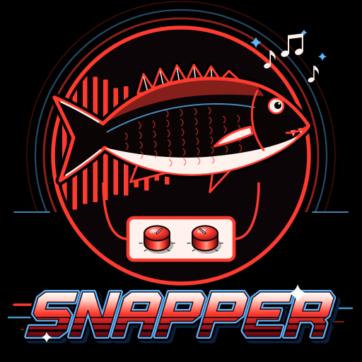
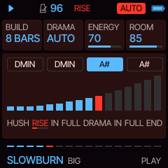
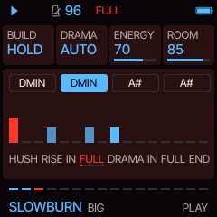
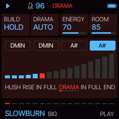
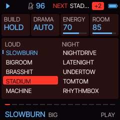
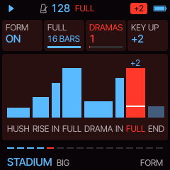
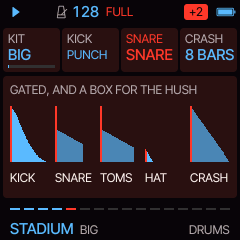

# Snapper

**Snappy generative 80s drum-heavy pop for the M-VAVE FM-1, caught in 1985.** Press PLAY and Snapper writes a song
around tension: a dark drone and a bare drum machine, building and building, until the big gated drums break in on
the downbeat with the whole band. Then a drama: the band falls away to one held chord while a tom roll swells in,
and the song comes back a key higher. Ten styles on two sides, LOUD and NIGHT. You decide how long it builds, fire the
break-in yourself, call the drama, and play the keys on top. Built on [Sill](https://github.com/delirioux/sill),
Daurade, [Tuna](https://github.com/delirioux/tuna) and [Felucca](docs/FELUCCA.md).

> **Version 0.1, in development.** Not yet tested on the FM-1: test builds come from `dev`. Built with no warranty.
> Felucca's or Tuna's installer, or the official V15, takes the FM-1 back.

## Install

Open **[delirioux.github.io/snapper](https://delirioux.github.io/snapper/)** in Chrome or Edge on a computer,
connect the FM-1 with a USB data cable and press Install (allow MIDI when the browser asks). The page checks the
package in the browser and writes it over USB-MIDI, as Felucca's installer does. Snapper keeps its settings and its
eight sets in Felucca's first two song slots: back up anything you made in Felucca first.

The test build from `dev` installs from [delirioux.github.io/snapper/dev](https://delirioux.github.io/snapper/dev/)
and plays in the browser at [delirioux.github.io/snapper/dev/try](https://delirioux.github.io/snapper/dev/try/)
(the same firmware, compiled to WebAssembly on Felucca's browser emulator). Every run also leaves its package in the
artifact `snapper-firmware`. From a terminal: `python3 tools/fm1_install.py snapper-X.Y.fwsc`.

## The four knobs

| | |
| --- | --- |
| **BUILD** | How long the tension lasts before the break-in: 8, 16 or 32 bars of hush and rise, or HOLD (the rise until you press REC). |
| **DRAMA** | AUTO: the song has its drama (or two, on the FORM page) after the full band; OFF: only when you press SEQ. |
| **ENERGY** | Density: from a sparse groove to sixteenth hats, pickup kicks and a busier drum machine in the rise. |
| **ROOM** | How big the drums sound: the room around the kit. The gated rooms of the snare, the clap and the toms are in the drums themselves. |

## How a song goes

| Section | What plays |
| --- | --- |
| **HUSH** | The drone: the chords held long, dark and soft. The drum machine comes in on the second bar, the hat first. |
| **RISE** | The bass joins halfway, the filter opens, the machine gets busier. The tension meter on the screen climbs. |
| **BREAK-IN** | One bar: the drum machine to its half, then a tom fill down the kit, and on the next downbeat the big gated drums, a crash and the whole band. |
| **FULL** | Everything: the gated kit, the bass line, the pads in the style's rhythm, the riff on the keys. A tom fill into the next section. |
| **DRAMA** | Four bars: the band drops away to one held chord, louder every two bars; a low tom rolls in for the last two. |
| **BREAK-IN** | A whole bar of toms, high to low, the last beat all of them. |
| **FULL** | The full band again, KEY UP higher (+2 by default). |
| **END** | Down to the machine and the bass, then the drone alone, and round again from the hush with a new riff. |

## Ten styles

| LOUD | | NIGHT | |
| --- | --- | --- | --- |
| **SLOWBURN** · 96 | the long drone and the machine, then the big drums: the tension is the song | **NIGHTDRIVE** · 112 | pulsing eighths on the pads and the bass, an arpeggio, dorian |
| **BIGROOM** · 118 | stomping pop with the snare up front, a pulsing synth, an anthem lead | **LATENIGHT** · 72 | a ballad: electric piano, a sliding bass, the drums late and huge |
| **BRASSHIT** · 124 | uptempo, horn-section stabs, slap bass, sixteenth hats | **UNDERTOW** · 84 | dark: a long drone, a sub bass, a choir now and then, hardly any drums |
| **STADIUM** · 128 | an anthem: wide held chords, an octave bass, a big lead riff | **TOMTOM** · 104 | rhythms on the toms instead of a backbeat, mallets |
| **MACHINE** · 100 | a menacing machine groove, a gated clap, a sparse bass | **RHYTHMBOX** · 98 | the drum machine plays on under a warm pad, the big snare only on four |

A style brings its own tempo, build, sounds, key, chord loop, groove, drums and space; your MIX, FORM and MENU stay.
A new style or song comes in on the next bar line. ALGORITHM picks another song in the same style: a new chord loop,
bass line, riff and sounds, the same each time you come back to its number.

## The controls

| | |
| --- | --- |
| SELECT | tempo |
| MASTER | volume |
| PRESETS | the style (the list shows while turning; it comes in on the next bar) |
| ALGORITHM | a new song in the same style (on the next bar) |
| KNOB 1-4 | the four cards on the screen (PLAY: BUILD DRAMA ENERGY ROOM) |
| PLAY | start (with the hush) / stop |
| REC | BREAK-IN. In the hush or the rise: tap it and the tom fill starts at the bar's half (the next bar's, when the half has passed), the full band on the downbeat after; hold it and the tension holds until you let go. In the full band: a tom fill into a crash. In a drama: back in on the next bar |
| SEQ | DRAMA: from the full band, on the next bar; it comes back a KEY UP higher |
| keys | KEYS, live, snapped to the scale: whatever you press is in key. The keys only ever play music |
| OCT- / OCT+ | the keys' octave |
| HOME | PLAY; hold it: MENU (COLOR, LOOK) |
| FX | SOUND (the four parts' sounds), again: TONE (RESO DRIVE DETUNE CRUSH) |
| LFO | KEYS (SPEED RANGE GATE REPEAT: the riff) |
| SCL | KEY (KEY SCALE CHORDS BARS) |
| ARP | GROOVE (SWING HATS BASS FILLS) |
| EDIT | DRUMS (KIT KICK SNARE CRASH) |
| GLO | MIX (the four levels), again: SPACE (REVERB DELAY TIME WIDTH) |
| ENV | FORM (FORM FULL DRAMAS KEY UP), again: KEYS |
| SAVE | SETS: eight sets on the knobs (SET, LOAD and STORE turned right, CLEAR turned right three times) |

The keys' LEDs glow on the notes of the chord playing. REC lights while it holds and through a break-in, SEQ in a
drama. MIDI out: PADS on channel 1, BASS on 2, KEYS on 3, the drums on 10 (General MIDI notes). The settings and
the sets save themselves while stopped. [docs/MANUAL.md](docs/MANUAL.md) goes through every page.

## The sound

Four parts on Felucca's engines, sixteen sounds each:

| Part | Sounds |
| --- | --- |
| PADS | DRONE, CHOIR, STRINGS, PWM, TINE, BRASS, PIANO, GLASS, SOFT, ORGAN, SYNTH, BELL, HORNS, ORCH, MALLET, VOICES |
| BASS | PUNCH, FM BASS, SLIDE (fretless), SYNTH, SQUARE, SUB, SLAP, OCTAVE, DX, FAT, SINE, GROWL, ORGAN, REESE, WOW, ACID |
| KEYS | TINE, BRASS, MALLET, SYNC, LEAD, HORNS, PIANO, FLUTE, POP, ANTHEM, ORCH, CHOIR, WHISTLE, PLUCK, ORGAN, SUPER |

FM is at home here: the TINE electric piano, the BRASS section, the MALLET wood bars and the BELL (a pad, never a style's own) are FM6 patches,
and so are Snapper's own DRONE (three detuned pairs swelling in slowly over a sub), GLASS (a soft pad with a bell's
shine) and PUNCH (a hard plucked bass). Each style has four sounds a part: song 1 plays its own, every other song
picks from the four.

The drums are Snapper's own, thirteen one-shots synthesized by [`tools/sn_drums.py`](tools/sn_drums.py) and
dedicated to the public domain (CC0): two kicks, the snare, the clap, three toms, the hats and a crash for the big
kit, and the drum machine's small kick, rim and hat for the hush. The snare, the clap and the toms carry their gated
room in the sample itself: a dense room held flat and cut dead after about a third of a second. So the FM-1 runs no
reverb of its own for it and it always sounds the same; the one thing you cannot turn is the gate's length. The KIT
card: BIG (these) or BOX (Felucca's DRUM engine, its 80 kit, for all of it).

Colours: GATE, Snapper's own (a dark red room, steel blue, snapper red), and all of Felucca's.

## Building

As Sill and Tuna (see [BUILDING.md](BUILDING.md)), with `FELUCCA_SNAPPER=1 ./build.sh`. GitHub Actions builds
every push to `main` and `dev` and publishes the site from either: main's release at the root, dev's test build
under `dev/` (`web/sn_make_site.py`). `sh tests/sn_tests.sh` runs the host tests; `sh tests/sn_felucca.sh OUTDIR`
renders a song through Felucca's engines to a WAV; `sh tests/sn_audition.sh` measures every sound's loudness;
`web/emu/sn_build.sh` builds the browser version. Design notes and the plan: [docs/DEVELOPMENT.md](docs/DEVELOPMENT.md).

## Credits and licence

GPL-3.0-only. Snapper by delirioux and Claude; a fork of Sill, Daurade, Flyfish and Tuna (delirioux), forks of
Felucca by Leo Kuroshita, Hügelton Instruments; the web installer is Felucca's. The drum samples are CC0. See
[CREDITS.md](CREDITS.md) and [LICENSING.md](LICENSING.md).
