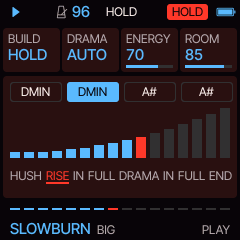
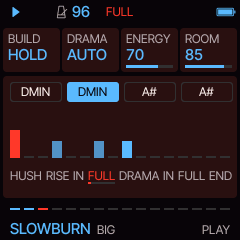
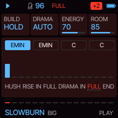
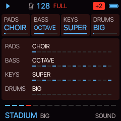
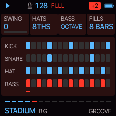

# Snapper manual

Snapper 0.1. Every page, every card. Four parts play: **PADS** (the chords, and the drone), **BASS**, **KEYS** (the
riff, and whatever you play on the keys) and **DRUMS** (the big gated kit and the drum machine). Knob 1 to 4 turn the
four cards on the screen. A page's button pressed again goes to its second page where it has one.

## Playing

PLAY starts with the hush (FORM on) and stops. PRESETS opens the list of the ten styles while you turn; the chosen
one comes in on the next bar line, NEXT in the header until it does. ALGORITHM picks a new song in the same style on
the next bar: its number seeds the chord loop, the bass line, the riff and the sounds, so a song always comes back
the same. SELECT is the tempo, MASTER the volume.

The header shows the section playing (HUSH, RISE, BREAK-IN, FULL, DRAMA, END) and, on the right, a badge: AUTO or
HOLD while the tension builds, HOLD while REC holds it, the key up (+1, +2, ...) after a drama. The footer's sixteen
dashes are the way through the section.

**REC is BREAK-IN.**

- In the hush or the rise, tap it: the break-in. Early in a bar (before its third beat) the tom fill starts at the
  bar's half, and the full band comes in on the next downbeat; later, the fill takes the next bar's half. A fill
  that starts mid-bar would land nowhere: this way the big drums always hit on beat one.
- In the hush or the rise, hold it: the tension holds (HOLD in the header) for as long as you keep it down, the rise
  going round its last bar. Let go and the break-in follows, as a tap.
- In the full band, tap it: a tom fill over the bar's last two beats (or the next bar's, late in the bar) into a
  crash on the downbeat.
- In a drama, tap it: back in on the next bar, without waiting for the drama's end.

**SEQ is DRAMA.** From the full band, on the next bar line: the band drops away to one held chord, a low tom rolls
in for the last two of its four bars, a whole bar of toms breaks back in, and the full band returns KEY UP higher.
Elsewhere SEQ says so and waits.

**The keys** play KEYS, live, snapped to the scale (and to the key up): any key you press is in key. While you hold
one, the riff makes way. OCT- and OCT+ move the keys' octave. The keys' LEDs glow on the notes of the chord playing.
The keys never change a setting.

## The form

With FORM on, a song goes:

| Section | Bars | What plays |
| --- | --- | --- |
| **HUSH** | BUILD / 2 (HOLD: 4) | The pads hold each chord of the loop, soft, the filter nearly shut. The drum machine from the second bar: its hat alone, then its kick and rim. |
| **RISE** | BUILD / 2 (HOLD: until REC) | The bass from halfway, long notes on the roots; the filter opening; the machine louder, its hat in sixteenths near the end with ENERGY above 45. |
| **BREAK-IN** | 1 | The pads and the bass on the loop's last chord (it leads home); the machine to the bar's half, then the toms high to low, the snare on the last sixteenth. |
| **FULL** | 8 or 16 | Everything: a crash and the big kit on the downbeat, the bass line, the pads in the style's rhythm, the riff. FILLS every 8 or 4 bars; a longer fill in its last bar. |
| **DRAMA** | 4 | One chord held, louder every two bars; the drums out, then a low tom rolling in, eighths and sixteenths, louder. |
| **BREAK-IN** | 1 | A whole bar of toms: eighths, sixteenths, the last beat the three of them, the snare. |
| **FULL** | 8 or 16 | Again, KEY UP higher. With DRAMAS 2, a second drama and a full band higher still. |
| **END** | 4 | The drum machine and the bass, then the drone alone; round again from the hush, home, with a new riff. |

With FORM off the full band plays on and on; REC fills, SEQ still brings a drama and the key up.

## The pages

| Page (button) | Cards |
| --- | --- |
| **PLAY** (HOME) | **BUILD** the hush and the rise together: 8, 16 or 32 BARS, or HOLD (the rise until REC). **DRAMA** AUTO (the form has its dramas) or OFF (SEQ only). **ENERGY** density: sixteenth hats, pickup kicks, a busier machine. **ROOM** the drums' room (on BOX, the kit's decay too). The panel: the chord loop, the tension meter (the hush, the rise, the drama, the end) or the bar as it plays (the full band), and the form with the section playing. |
| **SOUND** (FX) | **PADS**, **BASS**, **KEYS**: sixteen sounds each (the README lists them). Each style has four a part; song 1 plays its own, the other songs pick from the four (a card turned by hand holds until the next song). **DRUMS**: the kit, BIG (Snapper's own one-shots, gated, and the box) or BOX (Felucca's DRUM engine, its 80 kit). |
| **TONE** (FX again) | **RESO** the lifted filter's resonance. **DRIVE** saturation. **DETUNE** the chorus that thickens the pads and the keys. **CRUSH** bits and rate, down from clean. The panel: the filter the lift moves. |
| **KEY** (SCL) | **KEY** the root. **SCALE** MINOR, MAJOR, DORIAN, MIXOLYDIAN. **CHORDS** one of twelve chord loops. **BARS** a chord lasts 1, 2 or 4 bars. |
| **GROOVE** (ARP) | **SWING** on the sixteenths. **HATS** 8THS, 16THS or OPEN (offbeat). **BASS** the bass line in the full band: PULSE (eighths), LONG, SYNCO, OCTAVE, SEQ (a sequencer's sixteenths) or SLIDE. **FILLS** a tom fill over the last beat every 8 or 4 bars, or none. |
| **DRUMS** (EDIT) | **KIT** as on SOUND. **KICK** PUNCH or ROUND. **SNARE** the backbeat: SNARE, CLAP or BOTH. **CRASH** OFF, on each SECTION, or every 8 BARS in the full band too. The panel: each drum's shape, the gated ones a block held and cut dead. |
| **MIX** (GLO) | the four parts' levels (the pads sit 2 dB under the others at the same number). |
| **SPACE** (GLO again) | **REVERB**, **DELAY**, **TIME** the delay in 1/16, 1/8, 3/16 or 1/4, **WIDTH** the stereo spread. |
| **FORM** (ENV) | **FORM** on: the song has its form; off: the full band on and on. **FULL** 8 or 16 bars. **DRAMAS** 1 or 2 a song (with DRAMA AUTO). **KEY UP** what each drama adds: OFF, +1 or +2 semitones. |
| **KEYS** (ENV again, LFO) | **SPEED** SLOW (long notes), MID (eighths) or FAST (the syncopated sixteenths of a horn line). **RANGE** 1 or 2 octaves. **GATE** how long each note holds. **REPEAT** the riff's phrase: 1, 2 or 4 bars, a motif and its answer. The panel draws the riff, the note playing lit (NIGHTDRIVE: its arpeggio). |
| **SETS** (SAVE) | Eight sets: the whole song, style and all. **SET** picks one, **LOAD** and **STORE** turned right do it, **CLEAR** turned right three times empties it. |
| **MENU** (hold HOME) | **COLOR** the palette: GATE by default, and Felucca's. **LOOK** FLAT or LINE. |

A style sets its tempo, build, drama, energy, room, sounds, key, chord loop, groove, drums, space and riff; MIX,
FORM and MENU stay yours.

## MIDI out

PADS on channel 1, BASS on 2, KEYS on 3, the drums on 10 with General MIDI notes (the toms on 50, 47 and 43, the
drum machine's kick, rim and hat on 35, 37 and 42).

## Saving

The settings save themselves two seconds after the last change while stopped, never while playing (writing the
flash would stall the audio). They live in Felucca's first song slot, the sets in its second.
